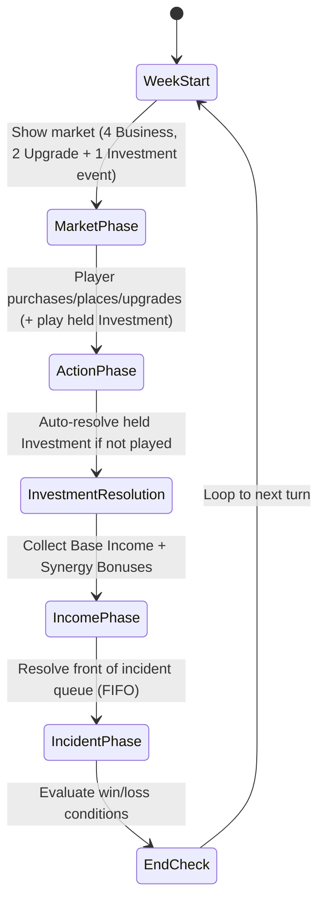

# The Build: Game Design Document (GDD)

> **Status update (CG-0MSLXJCHH001DLIO):** This historical GDD describes the original 20-turn design (``MAX_TURNS = 20``, "Turn 20" win/loss conditions). Default difficulty presets no longer impose a turn limit — games end via score threshold, all challenges, bankruptcy, or reputation collapse; a turn limit is opt-in via an explicit `maxTurns` config. See `docs/game/core-rules-and-mechanics.md` for the current rules. The 20-turn references below are retained for historical accuracy.

## Executive Summary

**Main Street** (working title: *The Build*) is a single-player, turn-based tableau card game where the player revitalises a 10-slot street grid by purchasing and placing business cards from a market. Adjacent (including diagonally adjacent) businesses sharing synergy types generate bonus income. The player manages two resources (Coins and Reputation) across 20 weekly turns, aiming to reach a difficulty-scaled score threshold (100 Easy / 120 Medium / 150 Hard) or complete all challenges. The game is built on the Tableau Card Engine using Phaser 3, TypeScript, and seeded deterministic RNG for reproducible sessions.

## Table of Contents
1. [Core Rules and Mechanics](#core-rules-and-mechanics)
2. [Content Design and Progression](#content-design-and-progression)
3. [UX, Visual Design, and Audio Direction](#ux-visual-design-and-audio-direction)
4. [AI Strategy and Hint System](#ai-strategy-and-hint-system)
5. [Glossary](#glossary)
6. [Milestone PRDs](#milestone-prds)

---

## 1. Core Rules and Mechanics

# Main Street: Core Rules and Mechanics

---

## 1. Game Overview

**Main Street** is a single‑player, turn‑based tableau card game built on the **Tableau Card Engine**. The player takes the role of a town planner revitalising a small main street by purchasing and placing business cards in a 10‑slot street grid. Each turn represents one week. Adjacent (including diagonally adjacent) businesses generate synergy bonuses, earn coins, and increase the town’s reputation. The game ends after a fixed number of turns or when a win condition is met. The design prioritises a fast‑to‑prototype core loop while delivering reusable engine components (grid, adjacency resolver, market, resource bank).

> **Update (CG-0MSLXJCHH001DLIO):** "Fixed number of turns" describes the original design; there is no default turn limit anymore.

---

## 2. Core Concepts

| Concept | Definition |
|---------|------------|
| **Slot** | A single cell in the 10‑slot **Street Grid** (rendered as a 2‑row × 5‑column layout) where a Business card may be placed. Slots are indexed 0‑9.
| **Business Card** | A card representing a shop or service. It has a cost, a base income, one or more **Synergy Types**, and optional **Upgrade Paths**.
| **Synergy Type** | A tag (e.g., *Food*, *Culture*, *Commerce*) that determines adjacency bonuses. When two adjacent businesses — orthogonally or **diagonally adjacent** (8‑way / Chebyshev adjacency, default range 1) — share a synergy type, each gains a **Synergy Bonus** equal to a percentage of its own effective base income per matching neighbor. The per-card rate defaults to 50% (`synergyCoinBonus` 0.5) and is scaled by the difficulty preset multiplier `synergyBonusPerNeighbor` (Easy 0.5 / Medium 0.35 / Hard 0.25, re-tuned by CG-0MSP26Q5N002EH8P). Same-type adjacent businesses do not receive synergy from each other.
| **Market** | The face‑up cards the player may purchase each turn. It has two rows: a **Business** row (4 slots) and a mixed **Investments** row (2 Upgrade cards + 1 Investment event card = 3 slots). Incidents are not purchasable; they populate a visible FIFO **Incident Queue** instead.
| **Resource Bank** | Holds the player's **Coins** (currency) and **Reputation** (plain score count). Coins start at 8 and Reputation starts at 3.
| **Turn** | A full week consisting of several phases (see Section 5). Turn number increments after the **week end**.
| **Event Card** | A card that triggers a one‑off effect (e.g., Festival, Tax, Storm). **Investment** events are player‑bought from the Investments row and held until played; **Incident** events resolve automatically from the incident queue.
| **Incident Queue** | A visible FIFO queue of 2 face‑up Incident cards. Each turn the front card is resolved and a replacement is drawn from the event deck. The player can see upcoming incidents and plan accordingly.
| **Upgrade Card** | A card that modifies a specific Business card (e.g., upgrade a Bakery to a Patisserie, increasing income and synergy range).
| **Challenge** | An optional meta‑goal (e.g., *Build a Foodie Row*) that grants a bonus score at the end of the game if satisfied.

---

## 3. Card Types and Anatomy

### 3.1 Business Card

| Field | Type | Description |
|-------|------|-------------|
| **Name** | string | Human‑readable title (e.g., *Bakery*). |
| **Cost** | number (coins) | Purchase price from the market. |
| **Base Income** | number (coins per turn) | Income generated each **WeekStart** before synergy. |
| **Synergy Types** | string[] | One or more tags that interact with adjacent cards (e.g., `Food`). |
| **Upgrade Path** | string (optional) | Identifier of the Upgrade card that can transform this business. |
| **Max Level** | number (optional) | Number of upgrade steps (default 1). |
| **Description** | string | Flavor text and any special rules. |

**Example Business Card (JSON‑like)**
```json
{
  "name": "Bakery",
  "cost": 3,
  "baseIncome": 2,
  "synergyTypes": ["Food"],
  "upgradePath": "Bakery→Patisserie",
  "description": "Provides warm pastries. Gains {SYNERGY_RATE} of base income per adjacent Food business."
}
```

### 3.2 Event Card

| Field | Type | Description |
|-------|------|-------------|
| **Name** | string | Title of the event (e.g., *Local Festival*). |
| **Trigger** | enum {`Investment`, `Incident`} | When the event resolves. **Investment** events are player-bought (generally positive) and held until played. **Incident** events happen automatically (generally negative). |
| **Effect** | string (DSL) | Human‑readable description of the effect (e.g., `+200 coins to all Food businesses`). |
| **Target** | enum {`All`, `SpecificSynergy`, `RandomBusiness`} | Scope of the effect. |

**Example Event Card**
```json
{
  "name": "Local Festival",
  "trigger": "Investment",
  "effect": "+200 coins to all Culture businesses and +100 reputation.",
  "target": "SpecificSynergy"
}
```

### 3.3 Upgrade Card

| Field | Type | Description |
|-------|------|-------------|
| **Name** | string | Title (e.g., *Upgrade to Patisserie*). |
| **Target Business** | string | Exact name of the business this upgrade applies to. |
| **Cost** | number (coins) | Purchase price from the market. |
| **Income Bonus** | number (coins) | Additional income added to the base income after upgrade. |
| **Synergy Range Bonus** | number (optional) | Extends the adjacency range for synergy (e.g., from 1 slot to 2 slots). |
| **Description** | string | Flavor text. |

**Example Upgrade Card**
```json
{
  "name": "Upgrade to Patisserie",
  "targetBusiness": "Bakery",
  "cost": 4,
  "incomeBonus": 1,
  "synergyRangeBonus": 1,
  "description": "Turns a Bakery into a Patisserie, increasing income and allowing synergy with businesses two slots away."
}
```

---

## 4. Game State Model

The engine maintains a single **GameState** object with the following fields (illustrated in TypeScript for reference):

```ts
interface GameState {
  turn: number; // starts at 1
  turnPhase: 'WeekStart' | 'MarketPhase' | 'EndCheck';
  streetGrid: (BusinessCard | null)[]; // length = GRID_SIZE (default 10)
  market: {
    business: BusinessCard[];                   // 4 face-up slots
    investments: (UpgradeCard | EventCard)[];   // 2 upgrades + 1 investment event = 3 slots
  };
  incidentQueue: EventCard[];  // Visible FIFO queue of upcoming Incidents (size 2)
  resourceBank: {
    coins: number; // start = 8
    reputation: number; // start = 3
  };
  deck: {
    business: CardDeck<BusinessCard>;
    event: CardDeck<EventCard>;    // Contains both Investment and Incident cards
    upgrade: CardDeck<UpgradeCard>;
  };
  hand: (BusinessCard | EventCard)[]; // merged hand: any mix, up to maxHandSize
  maxHandSize: number;                 // starts at 2, growable via management-company staff (Appendix D.4)
  challengesCompleted: Set<string>; // IDs of achieved challenges
}
```

**Key components**
- **Grid<T>** – generic NxM grid (used here as 2x5, storage row-major 0‑9). Provides `place(card, index)`, `neighbors(index)` (8‑way / Chebyshev adjacency) utilities.
- **AdjacencyResolver** – computes synergy bonuses based on shared `synergyTypes` and proximity (default range 1, can be extended by upgrades).
- **Market** – two rows: Business row (4 face‑up cards from the Business deck) and Investments row (2 Upgrades + 1 Investment event = 3 slots). Cards are replenished after purchase.
- **Incident Queue** – visible FIFO queue of 2 Incident cards drawn from the event deck. The front card resolves each turn during IncidentPhase; a replacement is drawn from the deck afterward. If the deck runs out, the queue shrinks naturally.
- **ResourceBank** – tracks `coins` (start 8) and `reputation` (start 3). Reputation counts 1:1 toward the final score (`finalScore = coins + reputation + challengeBonuses`).

---

## 5. Turn / Round Structure

The turn follows a deterministic state‑machine that repeats each week. The diagram below is a Mermaid **state diagram** that doubles as a flowchart for designers and developers.



**Phase details**
1. **WeekStart** – Increment `turn` counter, reset temporary flags, replenish market.
2. **MarketPhase** – The market shows 4 Business cards and 3 Investments (2 Upgrades + 1 Investment event). The player may purchase any combination as long as they have enough coins.
3. **ActionPhase** – The player resolves purchases:
   - **Buy Business** → `resourceBank.coins -= cost` → place card into a chosen empty slot (1 action).
   - **Buy Upgrade** → the market click **moves the card to hand (1 action)**; it is then applied from the hand by clicking the card and a matching business (same-week apply is a **free composite**; an upgrade held from a previous week costs 1 action). Dragging the upgrade from the market straight onto a matching business is a same-turn buy-and-apply: with **2+ actions** it charges the **discounted listed cost** and consumes **both** actions (drag + placement, no premium dialog); with **1 action** it charges the discount-first **+50% premium** and consumes 1 action, with the premium explainer dialog firing first — the same parity rule and gesture as the business buy-and-place (CG-0MT3IYSRL001VVUP, MS-0MVKT3TZF0091IHC).
   - **Buy Event (Investment)** → add the event card to the player's hand (any mix of business/event cards up to `maxHandSize`). The player may play it during MarketPhase via a `play-event` action.
   - **Play Event (from hand)** → resolve an Investment event card from the hand immediately and remove it.
4. **InvestmentResolution** – Reserved phase; Investment events are **not** auto‑resolved here. Unplayed events persist in the hand until the player plays them during a later MarketPhase.
5. **IncomePhase** – For each placed Business, compute:
   - `totalIncome = roundInt((effectiveBase + synergyBonus) × duplicateFactor)` where `effectiveBase = (baseIncome + incomeBonus) * sameTypePenalty` (0.6 for same-type neighbors), `synergyBonus = effectiveBase * synergyCoinBonus * bonusPerNeighbor * matchingNeighborCount` (percentage-based: `synergyCoinBonus` is the card's rate, defaulting to 0.5 = 50% of base income per matching neighbor; `bonusPerNeighbor` is the difficulty multiplier — 0.5 Easy / 0.35 Medium / 0.25 Hard (re-tuned by CG-0MSP26Q5N002EH8P)) and `duplicateFactor` is the street-wide market-saturation factor described below (1, full income, when the card's base type has no duplicate on its street). `matchingNeighborCount` counts 8‑way adjacent neighbors (orthogonal **and diagonal**, Chebyshev distance ≤ range).
   - **Market saturation (duplicate businesses)** (MS-0MVYG50V1007W8BP): when two or more businesses of the **same base type** occupy the **same street**, each earns a reduced share of its coin income — 2 copies → `2/3`, 3 copies → `1/2`, 4+ copies → `1/3` (a single copy keeps `1`, full income). The factor applies to the business's **total coin income** — the base after the adjacent same-type 60% penalty plus adjacency synergy — so the two penalties stack **multiplicatively**: `totalIncome = roundInt((effectiveBase + synergyBonus) × duplicateFactor)`. It is a coin-income rule only: **reputation is unaffected**. "Same street" means the same 5×2 street cell — the 1×1 (single-street) default board is one street, so all ten plots saturate together — and duplicates on different streets do not interact. Community-space cards are excluded from both the count and the factor. The rule is documented in full in `docs/game/core-rules-and-mechanics.md` and implemented by `src/MainStreetAdjacencyScoring.ts` + `src/MainStreetCardsConstants.ts`.
   - `resourceBank.coins += totalIncome`.
   - **Sold businesses** (CG-0MT5XUE2200047IJ): a sold card produces **0 income and 0 reputation for itself**, but remains a **synergy anchor** — its non‑sold neighbours keep the exact coin synergy, reputation synergy, and same‑type penalty they had before the sale (the sold card still counts as a matching neighbour and as a same‑type neighbour). A sold card also **still counts toward its type's street saturation**, so its base type keeps the market-saturation factor of the rule above for the other businesses of that type even though the sold card earns no income itself (it is excluded only from earning income, not from the copy count). Selling a business therefore never degrades the rest of the street.
6. **IncidentPhase** – Resolve the front Incident card from the visible FIFO incident queue. After resolution, draw a replacement Incident from the event deck to the back of the queue (maintaining queue size of 2). If the deck has no more Incidents, the queue shrinks naturally.
7. **EndCheck** – Evaluate win/loss conditions.
8. Loop back to **WeekStart** for the next turn.

The turn ends when either:
- The predefined maximum turn count (`MAX_TURNS = 20`) is reached, **or**
- The player meets a **Win Condition** (Section 7), **or**
- A **Loss Condition** (Section 8) triggers.

> **Update (CG-0MSLXJCHH001DLIO):** The `MAX_TURNS = 20` end condition is no longer a default game mechanic — it fires only when a config explicitly sets `maxTurns`.

---

## 6. Core Actions

| Action | Description | Preconditions | Result |
|--------|-------------|---------------|--------|
| **Buy Business** | Move a Business card from the market to the hand (`coins >= cost` at placement) and place it on an empty slot (1 action). | Market contains Business card; `actionsRemaining >= 1`; at least one empty slot. | Card moved to hand; action spent; listed cost paid when placed from hand (same-week placement is a free composite). |
| **Buy Upgrade** | Move an Upgrade card from the market to the hand (1 action); it is then applied from hand by clicking the card and a matching business. | Market contains Upgrade card targeting a placed Business at the required level; hand has room. | Upgrade moves to hand; action spent. Same-week apply is free; a held upgrade costs 1 action when applied. Dragging the upgrade straight onto a matching business buys-and-applies it: **2+ actions** → **discounted listed cost** + both actions (drag + placement); **1 action** → discount-first **+50% premium** + 1 action with the premium explainer dialog (MS-0MVKT3TZF0091IHC). |
| **Buy Event** | Take an Investment event card from the market into the hand **for free** (cost is paid when the event is executed from hand). | Market contains Investment event card; hand has room (`hand.length < maxHandSize`). | Event appended to hand; **no coins deducted** at take time. Player pays the event's listed cost when it is played during MarketPhase. There is **no limit on the number of event cards** in hand — only hand capacity (`maxHandSize`) applies. |
| **Play Event (from hand)** | Play an Investment event card from the hand during MarketPhase. | Player holds an Investment event card in hand; current phase is MarketPhase. | Event resolved and removed from hand. |
| **Place Business** | Choose an empty slot and put the purchased Business card there. | Business card in hand; slot is empty. | Card is now part of `streetGrid`. |
| **Sell Business** | Refund a placed Business/community-space card for **no action**; the card stays on the grid as an inert *sold* marker (still a synergy anchor, slot stays occupied). | MarketPhase; slot occupied and not sold. | Coins credited per the sell refund formula; `soldSlots[slot] = true`. |
| **Close Business** | Remove a placed Business/community-space card from the street for **1 action and no coins**; the card goes to the discard pile and the slot becomes empty again. Sold cards cannot be closed. | MarketPhase; slot occupied and not sold; `actionsRemaining >= 1`. | Card removed from `streetGrid` (slot → `null`); card pushed to `discardPile`; neighbours recalculated; 1 action consumed. |
| **Resolve Event** | Apply the effect described on an Event card. | Event card active. | Game state mutated per effect (coins, reputation, temporary modifiers). |
| **End Turn** | Transition to the next phase/state. | All desired actions for the week are complete. | Turn counter increments, flow moves to week end or next WeekStart. |

---

## 7. Win Conditions

The game is considered **won** when **any** of the following conditions are satisfied **at the end of a week end**:
1. **Score Threshold** – `finalScore >= winThreshold` where winThreshold is difficulty-scaled (100 Easy / 120 Medium / 150 Hard):
```ts
finalScore = resourceBank.coins + resourceBank.reputation + challengeBonus;
// challengeBonus = sum of 10 points per completed Challenge.
```
2. **Challenge Completion** – All **Primary Challenges** (defined in `docs/games/the-build/challenges.md`) are completed, granting an automatic win regardless of numeric score.
3. **Turn Limit Victory** – The player reaches **Turn 20** with a **positive reputation** (`reputation > 0`) and **coins >= 0**; the final score is then evaluated against the threshold. If the threshold is not met, the game ends as a loss.

> **Update (CG-0MSLXJCHH001DLIO):** Turn Limit Victory is opt-in — it only applies when a config explicitly sets `maxTurns`.

---

## 8. Loss Conditions

The game ends in **loss** if **any** of the following occur **immediately after a phase**:
- **Bankruptcy** – `resourceBank.coins < 0`.
- **Reputation Collapse** – `resourceBank.reputation <= 0` (the town is considered abandoned).
- **Turn Exhaustion Without Victory** – Turn 20 is reached and none of the win conditions in Section 7 are met.

> **Update (CG-0MSLXJCHH001DLIO):** Turn Exhaustion is opt-in — it only applies when a config explicitly sets `maxTurns`.

---

## 9. Randomness and Information

| Aspect | Random Source | Visibility |
|--------|----------------|------------|
| **Market Draw** | Seeded RNG draws from the Business, Upgrade, and Event decks to fill the Business row (4 slots) and Investments row (2 Upgrades + 1 Investment event). | Face‑up – player sees all options before purchasing.
| **Event Cards** | Incident events populate a visible FIFO queue (2 cards, face‑up) so the player can plan ahead. Investment events appear in the Investments market row and are purchased/held until played. | Incidents: face‑up in queue. Investments: face‑up in market, then held.
| **Challenge Generation** | Fixed set defined in `challenges.md`; no randomness.
| **RNG Seed** | Determined by the **Game Engine** on startup (`Math.seedrandom(seedString)`). | The seed is displayed on the title screen for reproducibility.

All randomness is **deterministic** when the same seed is used, enabling automated testing of the core loop.

---

## 10. Content Design and Progression

# Main Street: Content Design and Progression

---

### 1. Card Pool / Content Inventory

The **Main Street** game uses three distinct card families. Below is the current inventory of cards used in the prototype. The list is intentionally small for rapid iteration; additional cards can be added as the design evolves.

#### 1.1 Business Cards
| Name | Cost (coins) | Base Income (coins/turn) | Synergy Types | Upgrade Path | Description |
|------|--------------|--------------------------|----------------|--------------|-------------|
| Bakery | 3 | 2 | Food | Bakery → Patisserie | Provides warm pastries. Gains 50% of base income per adjacent Food business. |
| Diner | 4 | 3 | Food | Diner → Bistro | Serves quick meals. Gains 50% of base income per adjacent Food business. |
| Bookshop | 4 | 2 | Culture | Bookshop → Reader's Café | Sells books. Gains 50% of base income per adjacent Culture business. |
| Park | 2 | 1 | Culture | Park → Garden | Offers leisure. Gains 50% of base income per adjacent Culture business or community space. |
| Hardware Store | 5 | 3 | Commerce | Hardware Store → Home Improvement | Supplies tools. Gains 50% of base income per adjacent Commerce business. |
| ... *(additional business cards may be added later)* |

> **Historical note (pre-rescale, CG-0MU9NW9EP003B1AK):** this inventory predates the integer-economy rescale (CG-0MTIO1M15001E9Y6) and the Park reclassification (CG-0MQBLGQ2Z0066UGP). The **Park row above is stale** — Park is now the Tier-1 `community-space` card `cs-park` (cost 300, Entertainment synergy, 40 coins/turn running cost). See `content-design-and-progression.md` and `card-catalog.md` for current values.

#### 1.2 Event Cards

Event cards are split into two trigger types:

- **Investment** events are purchased from the Investments market row, held by the player, and played (or auto-resolved) during the turn. They are generally positive.
- **Incident** events populate a visible FIFO queue and resolve automatically at the start of each turn's Incident Phase. They are generally negative or disruptive.

| Name | Trigger | Effect |
|------|---------|--------|
| Local Festival | Investment | +200 coins per Culture business and +100 reputation. |
| Tax Audit | Incident | Lose 45% of banked coins (25% with the Accountant). |
| Rainy Day | Incident | -100 coin per Food business this turn. |
| Community Award | Incident | +200 reputation from community recognition. |
| Health Inspection | Incident | -200 coins per Food business and -100 reputation. |

**Deck composition:** 5 event templates × 3 copies = 15 cards total (3 Investment, 12 Incident). At game start, the Investments market row draws 1 Investment event and the incident queue draws 2 Incidents from the shuffled event deck.

#### 1.3 Upgrade Cards
| Name | Target Business | Cost (coins) | Income Bonus | Synergy Range Bonus | Description |
|------|----------------|--------------|--------------|----------------------|-------------|
| Upgrade to Patisserie | Bakery | 4 | +1 | +1 (adjacency range) | Turns a Bakery into a Patisserie, increasing income and allowing synergy with businesses two slots away. |
| Upgrade to Bistro | Diner | 4 | +1 | +1 | Turns a Diner into a Bistro with higher foot‑traffic. |
| Upgrade to Reader's Café | Bookshop | 300 | +100 | 0 | Transforms the Bookshop into a Reader's Café, blending books with café culture for +10 reputation per turn. |
| ... *(more upgrades as new businesses are introduced)* |

---

## 2. Recipes / Blueprints

Main Street does **not** feature crafting or combination mechanics. The game revolves around purchasing, placing, and upgrading business cards. Therefore, the **Recipes / Blueprints** section is **N/A** for this title.

---

## 3. Resource Economy

The core economic loop consists of two primary resources:
1. **Coins** – the spendable currency used to purchase Business, Event, and Upgrade cards from the market.
2. **Reputation** – a plain score count increased by completing challenges or by positive events. Reputation counts 1:1 at final‑score calculation (`finalScore = coins + reputation + challengeBonuses`).

**Flow of Resources**:
- At the start of each **WeekStart**, the player may spend coins to acquire cards.
- During the **Income Phase**, each placed Business generates `effectiveBase + synergyBonus` coins. Synergy is computed as a percentage of base income per matching adjacent Business sharing a Synergy Type: `synergyBonus = effectiveBase * synergyCoinBonus * bonusPerNeighbor * matchingNeighborCount`, where `synergyCoinBonus` defaults to 0.5 (50%) and `bonusPerNeighbor` is the difficulty preset multiplier (0.5 Easy / 0.35 Medium / 0.25 Hard, re-tuned by CG-0MSP26Q5N002EH8P).
- **Event Cards** may grant or remove coins/reputation immediately.
- **Upgrade Cards** increase future income and may extend synergy range.
- At the end of each turn, the player's **coin balance** and **reputation** are persisted in the **ResourceBank**.

---

## 4. Difficulty and Balance

The balancing methodology and targets for Main Street have been consolidated into a dedicated document at `docs/dev/balancing-methodology.md`. See [balancing-methodology.md](../dev/balancing-methodology.md) for the full methodology.

> **Migrated content**: Section 4 (Difficulty and Balance) has been moved to `balancing-methodology.md`. This section now serves as a cross-reference.

---

## 5. Scoring System

The final score is calculated at the end of the **week end** using the formula:
```
finalScore = resourceBank.coins + resourceBank.reputation + challengeBonus
```
- **Coins** contribute directly.
- **Reputation** counts 1:1 toward the final score.
- **Challenge Bonus** adds `10` points per completed challenge (e.g., *Foodie Row*, *Cultural District*).

Victory conditions (see Core Rules) require `finalScore >= winThreshold` (100 Easy / 120 Medium / 150 Hard) **or** all primary challenges completed.

---

## 6. Progression / Unlockables

Main Street features both **in‑run progression** and **meta‑progression** across runs.
### 6.1 In‑run Progression
- **Business Upgrades**: Spend coins to transform a Business (e.g., Bakery → Patisserie) increasing income and synergy range.
- **Challenges**: Dynamic objectives such as “Build a Foodie Row” provide immediate bonus points when satisfied.
### 6.2 Meta‑progression (Run‑to‑Run)
- After each run, players unlock new Business types from a larger pool, expanding the strategic palette for subsequent runs.
- Reputation carries over as a **persistent unlock tier**; reaching certain reputation milestones unlocks special Upgrade cards.
- A **Roguelike run structure** (one street per run) encourages repeated play to discover new combinations and improve the final score.

---

## 7. Replayability Hooks

To encourage multiple play‑throughs, Main Street incorporates:
- **Themed Street Challenges** (e.g., *Foodie Row*, *Cultural District*) that vary each run.
- **Event Cards with Meaningful Choices** (e.g., choose between a Festival that boosts Culture or a Market Fair that boosts Food).
- **Randomized Market** each turn, ensuring different acquisition opportunities.
- **Meta‑progression Unlocks** that gradually increase the card pool and upgrade options.
These hooks create emergent strategies while keeping the core loop short and satisfying.

---

## 8. UX, Visual Design, and Audio Direction

# Main Street: UX, Visual Design, and Audio Direction

## Summary

Write the UX and presentation section of The Build's Game Design Document covering the user interface layout, visual style, card art direction, animations, and audio/music direction.

## User Story

As a game designer, I want The Build's look, feel, and player interaction patterns documented so that implementation can deliver a cohesive, polished experience from the first milestone.

## Sections

1. **Screen Layout and Zones** – Where are The Build's game zones positioned on screen? Wireframes or descriptions of the main game view, menus, and overlays.
2. **Card Visual Design** – Card dimensions, layout of information on cards, visual hierarchy, face‑down appearance. Art style direction (pixel art, illustrated, minimalist, etc.).
3. **Interaction Design** – How does the player interact? Click/tap to select, drag and drop, contextual menus? Interaction feedback (highlights, hover states, invalid move indicators).
4. **Animation and Juice** – Key animations: card dealing, card movement, crafting/building effects, win/loss celebrations, score tallying. Timing and easing guidelines.
5. **Visual Theme and Mood** – Colour palette direction, mood board concepts, atmosphere goals. How does the visual design reinforce The Build's buildy/crafty theme?
6. **Audio Direction** – Sound effects needed (card sounds, crafting sounds, UI feedback, ambient). Music style and mood. Volume and mixing guidelines.
7. **Accessibility** – Colour‑blind considerations, text sizing, input method alternatives, screen‑reader hints (where feasible).
8. **Responsive/Resolution Considerations** – Target resolutions, scaling strategy, mobile vs desktop layout differences (if any).

## Expected Output

A formal GDD section with wireframes (ASCII/text‑based is acceptable), style guidelines, and interaction specifications sufficient for a UI developer to implement The Build.

## Acceptance Criteria
- Screen layout documented with zone positions and sizes.
- Card visual design specified with dimensions and info layout.
- All player interactions documented with feedback states.
- Key animations listed with timing targets.
- Visual theme direction established (even if assets are placeholder).
- Audio needs inventoried.
- Basic accessibility considerations documented.
- Document reviewed and approved by the producer.

---

## 9. AI Strategy and Hint System

# Main Street: AI Strategy and Hint System

> **Status (MS-0MVPWQLIH008R5M3): the hint feature is design intent only.**
> No hint feature is currently surfaced in the game. The original hint
> subsystem was removed — `MainStreetHint.ts`, the Hint action-bar control and
> its one-line rationale — and nothing shipped replaces it, so the sections
> below record the *intended* design, not current player-facing behaviour. The
> AI strategies described here drive AI seats and headless / Monte-Carlo runs;
> player-facing guidance today is the tutorial overlay plus the transient
> pop-text feedback channel (`docs/game/ux-visual-audio.md` § *Transient
> pop-text feedback channel*). The implemented AI design is documented in
> `docs/dev/ai-strategy.md`.

## Summary

Write the AI and player assistance section of The Build's Game Design Document covering AI strategy design for auto‑play, hint systems, and any tutorial/onboarding guidance.

## User Story

As a game designer, I want The Build's AI behaviour and player assistance systems documented so that we can deliver smart hints and compelling auto‑play from an early milestone.

## Sections

1. **AI Strategy Overview** – What does the AI need to do in The Build? (Auto‑play for testing/demo, hint generation, difficulty simulation)
2. **Strategy Tiers** – Define 2‑3 AI strategy levels:
   - **Random/Naive** – Makes valid moves randomly (baseline, useful for Monte Carlo testing)
   - **Heuristic/Greedy** – Follows simple priority rules (e.g. always craft if possible, prefer high‑value actions)
   - **Lookahead/Smart** (optional) – Considers future consequences of moves
3. **Hint System** – How are hints generated? Single best move? Multiple suggestions? Progressive hints (vague to specific)? *Design intent only — not currently surfaced in the game (MS-0MVPWQLIH008R5M3).*
4. **Move Evaluation Heuristics** – What makes a move "good" in The Build? Priority ordering of actions. Scoring function for comparing moves.
5. **Tutorial / Onboarding** – Is there a tutorial? How does The Build teach the player its mechanics? Guided first game? Tooltip‑based learning?
6. **Difficulty Adjustment** (if applicable) – Does the AI assist in difficulty? Dynamic difficulty? Selectable difficulty levels that change deal generation or available content?

## Expected Output

A formal GDD section covering The Build's AI design with enough detail for an engineer to implement the strategy classes using the engine's existing AI abstractions.

## Acceptance Criteria
- At least 2 AI strategy tiers are fully specified with decision logic.
- Hint system design documented with player‑facing behaviour. *(Satisfied as
  design intent only: the document states explicitly that the hint feature is
  not currently surfaced — MS-0MVPWQLIH008R5M3.)*
- Move evaluation heuristics defined and prioritised.
- Tutorial/onboarding approach documented.
- Design references existing engine AI abstractions (AiStrategyBase, AiPlayer, pickRandom, pickBest).
- Document reviewed and approved by the producer.

---

## Glossary

- **Slot** – A position on the street grid where a Business card may be placed.
- **Business staff** – A staff member employed at a single business, whose effect is scoped to that business and (where stated) its 8-way neighbours. See Appendix D.4.
- **Management-company staff** – A staff member employed by the player (the management company), whose effect is scoped to the player's turn — hand, actions, market, incident insight, street-wide economy. See Appendix D.4.
- **Synergy** – Bonus income earned when adjacent businesses share a Synergy Type.
- **Resource Bank** – Holds Coins and Reputation.
- **Challenge** – Optional meta‑goal that provides bonus points.
- **AI Strategy** – Algorithm used by the computer to decide actions.
- **Hint** – Design-intent concept: a suggested move that would be presented
  to the player. Not currently surfaced in the game
  (MS-0MVPWQLIH008R5M3).

---

## Milestone PRDs

The GDD is implemented through incremental milestones, each with its own PRD:

| Milestone | PRD Document | Work Item | Status |
|-----------|-------------|-----------|--------|
| **M1: Playable Core Loop (Walking Skeleton)** | [prd-milestone-1.md](../dev/prd-milestone-1.md) | CG-0MM4RDYAU1DY4OG8 | Draft |

---

## Test Plan

Testing is defined per-milestone in each PRD. The overall test strategy:

1. **Unit tests** for all game logic (state, rules, adjacency, income, win/loss).
2. **Integration tests** for full-turn and full-game flows.
3. **Determinism tests** verifying that identical seeds produce identical outcomes.
4. **Demo scripts** for headless deterministic runs producing JSON transcripts.
5. **Playtest checklists** for manual verification of fun factor and UX.

All tests are run via `npm test` (Vitest). Build validation via `npm run build`. See [prd-milestone-1.md](../dev/prd-milestone-1.md) Section 7 for the Milestone 1 test plan.

---

## Appendix D: Multi-Use Card Economy (Digital Adaptation)

*Added in CG-0MQRXN2CT0076OW7 (v0.1.2+)*

Main Street's economy was extended with a **multi-use card economy** where every purchased business card has dual purpose: place it directly onto the tableau or hold it in hand for future placement. Hand cards contribute **no** synergy income (removed, CG-0MTR317Q2003YCDN / CG-0MTRDX0DN004EECN). This section summarises the digital-only mechanics.

### D.1 Player Hand

- Each player has a **hand** holding business cards (initial capacity: 2).
- Cards purchased from the market can be placed in the hand instead of on the tableau.
- Hand capacity is displayed in the UI as "Hand: N/M".
- Only **management-company staff** add hand slots (Appendix D.4.4); **business staff** are employed at a single business and never change hand capacity.

### D.2 Hand Cards Do Not Generate Synergy

- Cards in the hand are not in play and provide **no** income or synergy during the IncomePhase (CG-0MTR317Q2003YCDN / CG-0MTRDX0DN004EECN).
- Synergy is generated only by placed businesses on the street: different-type businesses sharing a `SynergyType` on adjacent (8-way) slots earn percentage-based income synergy baked into `currentIncome`.
- Hand cards begin contributing once placed onto the street.

### D.3 Market Cycling

- At the end of each MarketPhase, all unpurchased market cards move to their respective discard piles.
- The market is then refilled from the decks.
- Discard piles reshuffle into decks when depleted.

### D.4 Staff System

*Rewritten by MS-0MW2XMA0Z007MZ6D (parent epic **MS-0MW20VBSZ003A01O**), superseding the three-tier hand-capacity model that previously occupied this appendix.*

Staff are the management layer of the Main Street economy. A **staff card** (`family: 'staff'`) is a hireable template that is either employed at a **single business** or employed by the **management company** — the player. Every staff member belongs to exactly one of those two types, and the type decides, in one glance, **what the member may affect, where the member is assigned, and how the player interacts with them**.

The design commits to exactly **two types** — not a spectrum, not a third category:

- **Business staff** — assigned to one street business; their effect is scoped to that business and, where the role says so, to the businesses immediately around it.
- **Management-company staff** — assigned to the management company (the player); their effect is scoped to the player's turn: hand, actions, market, incident insight and street-wide economy.

Every staff card does **not** occupy a hand slot. Salaries are ongoing per-turn costs deducted during the IncomePhase (clamped at 0 coins and logged).

#### D.4.1 The two types at a glance

| Dimension | Business staff | Management-company staff |
|---|---|---|
| **Scope of effect** | The **employing business**, plus the businesses 8-way adjacent to it where the role explicitly says so (its local cluster). Effects resolve **per business**, never street-wide. | **The player (the management company)**: hand capacity, action budget, per-turn reputation, market prices, market re-rolls and incident-deck insight. Effects are street-independent and persist whatever is on the grid. |
| **Where assigned** | Employed at **one business slot** (recorded as `employedAtSlot`). Placement is chosen at hire; the member lives on that business. | Employed by the **company itself** — no street slot, no `employedAtSlot`. The member never appears on the grid. |
| **Who pays the salary** | The business it is employed at; the salary is an operating cost of that business, deducted from the player's coins in the IncomePhase. | The management company; deducted from the player's coins in the IncomePhase. |
| **Lifetime** | Active only while its business is on the street. Selling the business ends the effect and the salary with it. | Active for as long as the member is employed; independent of the street's composition. |
| **How the player interacts** | Hire from the market row (**1 action**) and **choose the destination business**. The destination must match `allowedBusinessTypes` and have a free employment slot (`max(1, level + 1)` per business). Relocating an employed member to another business costs **1 action**; the initial placement at hire is free. | Hire from the market row (**1 action**) and the member joins the company immediately — no placement step, no relocation. Its ability applies from the next IncomePhase. |
| **Design purpose** | **Business-level efficiency and profit**: raise one business's output, lower its costs, or strengthen its immediate cluster. | **Widen what the player can do in a turn**: capacity, tempo, information and prices. |
| **Card-data marker** | `handSlotsAdded = 0`; the ability is expressed as a per-business buff. | At least one player-scope ability field (`handSlotsAdded > 0`, `actionsPerTurn`, `peekOncePerTurn`, `refreshCostDiscount` or `taxAuditRate`). |

#### D.4.2 How a staff member's type is determined and assigned

1. **The type is a property of the card template.** It is fixed at design time and printed on the card; the player never chooses the type, only (for business staff) the destination business.
2. **The runtime determinant is assignment.** A staff member is **business staff** if and only if it carries an `employedAtSlot` — the street-grid slot index of the business that employs it. A staff member with no `employedAtSlot` is **management-company staff**. This is the single testable rule the rest of the system derives from.
3. **Assignment rules.**
   - Hiring business staff **requires** a destination business: the destination must match the member's `allowedBusinessTypes` (business names and/or synergy types) and have a free employment slot (`max(1, level + 1)`; a level-0 business has one).
   - Hiring management-company staff **never** asks for a destination, and an attempt to place one on a business is rejected.
   - Only business staff may be relocated; relocation costs 1 action and is atomic with a successful move (an illegal attempt spends nothing) and is undoable.
4. **Salaries.** Every employed member — of either type — adds its ongoing cost to the IncomePhase deduction. The deduction is clamped at 0 coins (the player is never driven negative) and logged.
5. **Lay-off.** Letting a member go is available from the Manage Card dialog of the business that employs it (business staff) or from the company roster (management-company staff). Lay-off costs one turn's salary (clamped at 0) and 1 reputation; the member's buffs stop applying from the next IncomePhase.
6. **Applicants.** The per-turn walk-on applicant flow hires at 0 coins and consumes no action. The applicant's type decides the flow: a business-staff applicant targets a business with a free slot (drawn from the deployed businesses), a management-company applicant joins the company.

#### D.4.3 Business staff — roles and impacts

Business staff are the **specialists**: each is employed at one business and pays for itself out of that business's local economy. The table lists the full business-staff roster. Every role states **one unique benefit** with its concrete magnitude and direction; no two roles share a benefit.

| Card | Role | Tier | Salary (coins/turn) | Employed at | Unique benefit (magnitude and direction) | Redesign delta vs. shipped card |
|---|---|---|---|---|---|---|
| `staff-barista` | Barista | 2 | 50 | Any Cafe, or any Food-type business | **+20 coins/turn** to **each adjacent Food business** (flat synergy coin) | — |
| `staff-baker` | Baker | 2 | 80 | Any Bakery, or any Food-type business | **+25 coins/turn** to **its own business** | Narrowed from adjacent Food businesses to its own business |
| `staff-chef` | Chef | 3 | 100 | Cafe, Diner, Delicatessen, or any Food business | **+20% coin income** to **its own business** (applied after synergy, before market saturation) | — |
| `staff-florist` | Florist | 2 | 75 | Any Flower Shop, or any Commerce/Culture business | **+30 coins/turn** to **each adjacent Commerce or Culture business** | — |
| `staff-mechanic` | Mechanic | 3 | 90 | Hardware Store, or any Service business | **+30 coins/turn** to **its own Service business** | — |
| `staff-bookkeeper` | Bookkeeper | 2 | 50 | Commerce, Food or Service business | **−20% ongoing cost** of **its own business** (rounded up, floored at 0) | — |
| `staff-financial` | Financial Advisor | 5 | 125 | Commerce business | **−100 coins** on **each upgrade** purchased for **its own business** (floored at 0) | — |
| `staff-it` | IT Specialist | 4 | 100 | Commerce, Entertainment or Service business | **+1 synergy range** for **its own business** (it links with businesses up to 2 slots away) | Was a street-wide −100 market-refresh discount (player-scoped; did not fit the business-staff scope) |
| `staff-delivery` | Delivery Driver | 2 | 50 | Food or Commerce business | **−50 coins** on the purchase cost of **any business placed adjacent to its own business** | Was a street-wide purchase discount |
| `staff-security` | Security Guard | 3 | 75 | Any business | **−10% coin damage** from Incidents for **its own business and its adjacent businesses** (rounded down) | Was street-wide |
| `staff-maintenance` | Maintenance Worker | 3 | 75 | Any business | **−50 reputation damage** from Incidents for **its own business and its adjacent businesses** (floored at 0) | Was street-wide |
| `staff-health-safety` | Health & Safety Inspector | 4 | 100 | Health business | **−10% Incident frequency** for **its own business** (deterministic per-turn avert) | Was scoped to all Health businesses on the street |
| `staff-customer-rep` | Customer Service Rep | 2 | 50 | Any business | **+10 synergy reputation/turn** to **each adjacent business** | — |
| `staff-marketing` | Marketing Consultant | 3 | 100 | Commerce, Food or Culture business | **+10% reputation from all sources** for **its own business** | Was street-wide |
| `staff-pr` | PR Officer | 4 | 100 | Any business | **+15 reputation/turn** to **its own business** | Was all businesses on the street |
| `staff-event-planner` | Event Planner | 3 | 75 | Entertainment business | **+100 coins/turn** from **each adjacent Entertainment business** (synergy coin) | Clarified as an adjacency effect |
| `staff-investor` | Investor | 5 | 125 | Any business | **One coin-free, action-free market re-roll per turn**, with each drawn slot **75% biased** towards its own business's synergy types | — |

**Reading the table.** "Its own business" means exactly the business recorded in `employedAtSlot`; "adjacent" means the 8-way (orthogonal + diagonal) neighbours of that business, so a business-staff effect can cover at most the employing business plus its neighbours. A sold business's staff stop producing an effect (and stop costing a salary) — the member is let go with the business.

#### D.4.4 Management-company staff — roles and impacts

Management-company staff are the **company layer**: they never stand on the street, they are paid by the player, and they change the shape of a turn rather than the output of a single business. Every role states **one unique benefit**; no two roles share a benefit.

| Card | Role | Tier | Salary (coins/turn) | Unique benefit (magnitude and direction) | Redesign delta vs. shipped card |
|---|---|---|---|---|---|
| `staff-apprentice` | Apprentice | 1 | 50 | **+1 hand slot** | — |
| `staff-assistant` | Assistant | 2 | 100 | **+2 hand slots** | Was +1 hand slot |
| `staff-manager` | Manager | 3 | 250 | **+1 hand slot and +1 action/turn** | — |
| `staff-director` | Director | 9 | 400 | **+3 hand slots and +1 action/turn** | — |
| `staff-executive` | Executive | 10 | 500 | **+2 actions/turn** | Was +1 hand slot and +1 action/turn |
| `staff-general-manager` | General Manager | 12 | 500 | **+4 hand slots and +1 action/turn** | — |
| `staff-socialite` | Socialite | 4 | 150 | **+10 reputation/turn** | — |
| `staff-accountant` | Accountant | 6 | 150 | **−100 coins on every market refresh**, and **Tax Audit losses capped at 25%** of the assessed amount | — |
| `staff-lookout` | Lookout | 7 | 200 | **Reveals the top card of the incident deck** (peek) **once per turn** | — |

#### D.4.5 Expected gameplay outcomes and strategic trade-offs

**Business staff drive business-level efficiency and profit.** Each one is a local multiplier: the player pays a fixed salary to raise the coin or reputation output of a single business (or to cut its costs, upgrades or the price of its neighbours). Because the gain is local, the return scales with the business itself — a high-income business with several matching neighbours turns a +20% or +20/turn buff into a large absolute gain, while the same member on a thin, isolated business barely covers its salary. Business staff therefore reward **street composition** (clusters, synergy density and upgrade levels) and are the main lever for turning a good location into a great one. Their ceiling is deliberately local: one business's staff cannot lift the whole street, and selling the business ends their contribution.

**Management-company staff widen what the player can do in a turn.** Their benefits are capacity and tempo: extra hand slots let the player hold more options, extra actions let the player convert those options into placements, upgrades and sales, and market and incident insight (peek, re-roll, refresh and tax discounts) lowers the variance and the price of every decision. Because the benefit is player-scoped, it is **independent of what is on the street** — it keeps paying even on a turn with no good purchase — but it does **not** scale with the street: two extra actions are only worth what the player can find to spend them on, and an extra hand slot is only worth what the player can afford to fill it with.

| Decision | Business staff | Management-company staff |
|---|---|---|
| **Payoff shape** | Scales with the employing business's own output and its synergy neighbours | Scales with how many actions and hand slots the player can convert into placed, upgraded and sold cards |
| **Best when** | The street holds a strong local cluster and the player intends to keep and upgrade those businesses | The player is action-starved, hand-capped, or losing value to market refreshes and incidents |
| **Fails when** | The business is sold, left un-upgraded, or isolated from matching neighbours | The player is already unconstrained — extra capacity cannot be spent |
| **Ongoing risk** | Salary is wasted if the business is idle or sold | Salary is a fixed drain that does not shrink when the street does |
| **Information value** | Low: the payoff is visible in the business's own numbers | High: peek and re-roll reduce incident and market variance |
| **Compounding** | With synergy, upgrades and adjacent businesses | With everything the player can afford to place |

A worked comparison: on a Food cluster, a Barista (+20 coins/turn to each adjacent Food business) covering two neighbours returns +40 coins/turn; the same salary spent on a Manager returns +1 action and +1 hand slot per turn, which is worth a full extra placement only if the player has the coins and a card to spend it on. The two types are therefore **complementary but not interchangeable**: business staff are the profit engine once the street exists; management-company staff are what lets the player build the street in the first place.

> **Balance note.** All magnitudes in this appendix are **directional and provisional**. They exist to state intent and to make the two types testable, not to lock balance; final values are set by playtest.

#### D.4.6 Supersession of the old three-tier hand-capacity model

The three-tier model that previously occupied this appendix (Assistant / Manager / Director as pure hand-capacity purchases) is **superseded** and must not be used as a description of staff anywhere in the documentation. The reasons it cannot stand:

- It described staff as a single lever (**hand slots**) with three magnitudes; the roster now has **two types and 26 distinct roles**, and 17 of the 26 grant **no hand capacity at all**.
- It had no notion of *where* a staff member works, so it could not express business-scoped effects.
- Its lay-off rule ("removing random hand cards equal to slots provided") contradicted the implemented lay-off: one turn's salary plus 1 reputation.

| Old tier (superseded) | Old benefit and cost | Replaced by |
|---|---|---|
| Assistant | +1 hand slot; cost 3, ongoing 1 (old currency scale) | **Assistant**, management-company staff: **+2 hand slots**; tier 2, salary 100 |
| Manager | +2 hand slots; cost 6, ongoing 2 (old currency scale) | **Manager**, management-company staff: **+1 hand slot and +1 action/turn**; tier 3, salary 250 |
| Director | +3 hand slots; cost 10, ongoing 3 (old currency scale) | **Director**, management-company staff: **+3 hand slots and +1 action/turn**; tier 9, salary 400 |

The following statements from the old appendix remain true and are carried forward: staff cards do **not** occupy hand slots, ongoing costs are deducted each IncomePhase, and hand capacity is displayed as "Hand: N/M".

#### D.4.7 Mapping the shipped 26 staff cards

The roster in D.4.3 and D.4.4 **is** the remap of the 26 staff templates shipped in `src/card-data.csv`, and it accounts for every one of them with no card left unclassified and no card described by two types:

- **9 management-company staff** — the cards that grant hand capacity (`handSlotsAdded > 0`), action points (`actionsPerTurn`) or street-independent player benefits: Apprentice, Assistant, Manager, Director, Executive, General Manager, Socialite, Accountant, Lookout.
- **17 business staff** — the per-business cards (`handSlotsAdded = 0`): Barista, Baker, Chef, Florist, Mechanic, Bookkeeper, Financial Advisor, IT Specialist, Delivery Driver, Security Guard, Maintenance Worker, Health & Safety Inspector, Customer Service Rep, Marketing Consultant, PR Officer, Event Planner, Investor.

The "Redesign delta" columns in D.4.3 and D.4.4 name every card whose shipped effect is **re-scoped or re-valued** to fit the two-type model (scope tightenings for Security Guard, Maintenance Worker, Health & Safety Inspector, Marketing Consultant, PR Officer, Delivery Driver and IT Specialist; value changes for Assistant, Executive, Baker and Event Planner). Those deltas are **implementation follow-ups**, not part of this documentation work item; until they land, the shipped behaviour is the older, wider-scoped version.

#### D.4.8 Implementation contract (what downstream work must satisfy)

The section is deliberately precise enough to drive implementation and audit. The following invariants are authoritative and testable:

1. **Type is assignment.** `isBusinessStaff(member) === (member.employedAtSlot !== undefined)`; a management-company staff member never carries `employedAtSlot`.
2. **Scope.** A business-staff buff resolves **only** against its `employedAtSlot` business or that business's 8-way neighbours. A management-company buff resolves against the player and must not touch an individual business's income or reputation.
3. **Capacity marker.** `handSlotsAdded > 0` implies management-company staff; business staff always have `handSlotsAdded = 0`.
4. **Player-scope fields are management-company-only.** `actionsPerTurn`, `peekOncePerTurn`, `refreshCostDiscount` and `taxAuditRate` must not be set on a business-staff template. Business-staff reputation and cost effects must be modelled as per-business buffs, not through the street-wide `reputationPerTurn` field.
5. **Employment capacity.** A business holds at most `max(1, level + 1)` staff members, and a member may only be placed at a business matching its `allowedBusinessTypes`.
6. **Removal is complete.** Selling a business or laying off a member removes the effect and the salary from the same IncomePhase; no buff survives its employment.
7. **Determinism.** Every staff effect is deterministic given the seeded RNG; the Investor's re-roll bias, the Lookout's peek and the Health & Safety Inspector's incident avert all consume the documented RNG stream only.

Existing fields this contract relies on (see `src/MainStreetCardsTypes.ts`): `handSlotsAdded`, `employedAtSlot`, `allowedBusinessTypes`, `reputationPerTurn`, `refreshCostDiscount`, `upgradeCostDiscount`, `purchaseCostDiscount`, `taxAuditRate`, `actionsPerTurn`, `peekOncePerTurn`, `freeMarketRerollPerTurn` and `marketRelevanceBias`.

### D.5 Removed Mechanics

The following mechanics from the physical design are **removed** in the digital adaptation:

| Mechanic | Replacement |
|----------|-------------|
| Stock/Tuck | Multi-use hand economy |
| Dedicated Sell action | Card sell at 75% value |
| Renovate action | Card sell |
| Restock action | Market cycling |
| Open Shop action | Tableau placement from hand |

### D.6 Implementation

See `docs/dev/prd-multi-use-card-economy.md` for the complete technical specification, architecture, and test coverage details.

---

*Document status*: AWAITING PRODUCER REVIEW.

*Prepared by*: `opencode` – implementation of work item **CG-0MM4RDIMT1HLP2DE**.

*Multi-Use Card Economy section by*: `Map` – implementation of work item **CG-0MQRXN2CT0076OW7**.
